# Building with Amazon Bedrock

IDS 706 · Week 13 Workshop · November 21, 2026

I used a campus library’s charger-lending desk as a running example. It gave me something concrete to test, from asking a chatbot to remember a project name to drafting a reply to student feedback. The most useful surprise came from the retrieval labs. A plausible answer can hide a poor search result, so I started checking what the model received before judging what it said.

## Labs and evidence

I completed the 12 required labs and worked through three optional Basic Patterns labs in the AWS workshop account (`us-west-2`). For S1 and S2, I reused the guardrails from my earlier setup and confirmed that both published versions were ready. The links below go to the relevant walkthrough or the exact screenshot that shows the result.

| Lab | What I tested and observed | Where to look |
|---|---|---|
| B1 · Text generation | Nova Pro explained office hours for a first-year student. | [Figure 1](#fig-text), B1 row |
| B2 · Retrieval-augmented generation | Titan and Chroma retrieved FAQ context that Nova Lite used to answer a question about customer data and model training. | [Walkthrough](#lab-b2) |
| B3 · Chatbot | The assistant recalled **Library Queue** when I asked for the project name in a second turn. | [Walkthrough](#lab-b3) |
| I1 · Chatbot with RAG | Nova Pro requested the FAQ tool, received retrieved context, and answered the model-training question. | [Walkthrough](#lab-i1) |
| I2 · Document summarization | Nova Pro took a PDF and a custom instruction and returned three bullets, including a practical next step. | [Walkthrough](#lab-i2) |
| I3 · Response streaming | A `ConverseStream` callback received 128 text deltas totaling 1,583 characters in one run. | [Figure 1](#fig-text), I3 row |
| I4 · Embeddings search | Chroma returned four FAQ hits. The first addressed customer data and model training. | [Figure 1](#fig-text), I4 row |
| S1 · Console guardrail | The guardrail created in the console had a published version 1 in `READY` status. | [Figure 3](#fig-safeguards), S1 row |
| S2 · Programmatic guardrail | The guardrail created through the SDK also had a published version 1 in `READY` status. | [Figure 3](#fig-safeguards), S2 row |
| S3 · Invoke models with guardrails | Nova Lite returned `end_turn` for the control and `guardrail_intervened` for a configured word match. | [Walkthrough](#lab-s3) |
| S4 · Content blocking | The neutral library prompt passed. The synthetic blocked term `AnyCompany` triggered an intervention. | [Figure 3](#fig-safeguards), S4 row |
| S5 · PII masking | The standalone guardrail returned `{NAME}` and `{EMAIL}` in place of the synthetic values. | [Walkthrough](#lab-s5) |
| S6 · Prompt attack blocking | The public-notice control passed. The filter classified a synthetic formatting override as `PROMPT_ATTACK` and blocked it. | [Figure 3](#fig-safeguards), S6 row |
| Bonus 1 · Prompt showcase | The reply template picked up the charger desk and statistics lab details from my sample feedback. | [Walkthrough](#lab-o1) |
| Bonus 2 · Text generation playground | I generated names with Nova Micro at different temperatures. The browser run produced ChargeSwap, PowerShare, and ChargerSwap. | [Walkthrough](#lab-o2) |

[Basic Patterns](https://catalog.us-east-1.prod.workshops.aws/event/dashboard/en-US/workshop/basic) · [Text Patterns](https://catalog.us-east-1.prod.workshops.aws/event/dashboard/en-US/workshop/intermediate) · [Security & Safeguards](https://catalog.us-east-1.prod.workshops.aws/event/dashboard/en-US/workshop/security-safeguards) · [Bonus Labs](https://catalog.us-east-1.prod.workshops.aws/event/dashboard/en-US/workshop/bonus)

## Basic Patterns

<a name="lab-b2"></a>

### B2 · Retrieval-augmented generation

I wanted to see what happened when the model had a small FAQ collection to work with. I ran the example below from `labs/rag`, the same directory as `rag_app.py`. The helper embeds the question with Titan Text Embeddings v2, retrieves the four nearest FAQ entries from the local Chroma collection, and passes them with the question to Nova Lite.

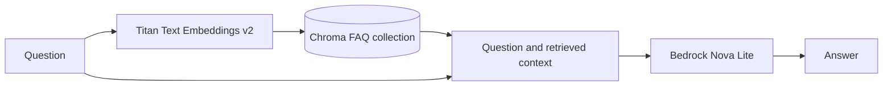

```python
from rag_lib import get_rag_response

question = "Does Amazon Bedrock use my inputs and outputs to train its models?"
result = get_rag_response(question)
print(result)
```

**What I saw.** The B2 row in [Figure 1](#fig-text) shows the answer beginning with the retrieved context and stating that AWS and third-party model providers do not use customer inputs or outputs for training. The I4 row shows the matching FAQ surfaced by a separate similarity search. An earlier monitoring question surfaced a customer-data FAQ, which made me want source titles and passages visible beside any answer I ship.

<a name="lab-b3"></a>

### B3 · Chatbot with session history

From `labs/chatbot`, I sent a project name in one turn and asked the chatbot to recall it in the next. The app keeps the messages in its session and sends the role-tagged history with each request. The example calls the same helper as `chatbot_app.py`.

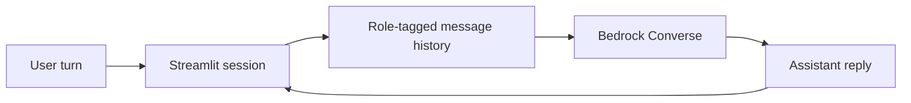

```python
from chatbot_lib import chat_with_model

history = []
chat_with_model(history, "Remember my synthetic project name: Library Queue.")
chat_with_model(history, "What is the project name?")
assert "library queue" in history[-1].text.lower()
```

**What I saw.** The B3 row in [Figure 1](#fig-text) shows the follow-up response containing **Library Queue** even though the second user message did not include it. I’d keep recent turns and summarize older ones if a future version needed to handle longer conversations.

## Text Patterns

<a name="lab-i1"></a>

### I1 · Chatbot with retrieval as a tool

I reused the B2 FAQ question so I could compare the two workflows. From `labs/rag_chatbot`, I started with an empty conversation. The helper sends Nova Pro a tool definition along with the user’s message. When Nova Pro requests a lookup, the helper embeds the search query, retrieves four FAQ entries from Chroma, and sends the tool result back for the final answer.

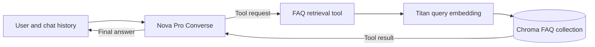

```python
from rag_chatbot_lib import chat_with_model

history = []
chat_with_model(history, "Does Amazon Bedrock use my inputs and outputs to train its models?")
assert len(history) == 2 and "does not" in history[-1].text.lower()
```

**What I saw.** The top of [Figure 1](#fig-text) shows the `QUERY`, `RAG CONTENT`, and `FINAL RESPONSE` markers followed by the answer excerpt. That trace records that the tool path ran for this question. B2 searches before every model call. In I1, the model decides whether it needs to search, so I’d track tool use as well as answer quality when evaluating the chat app.

<a name="fig-text"></a>


*Figure 1. The top four lines show the I1 retrieval trace and the beginning of the model’s answer. The labeled rows below show the streaming count (I3), the first of four FAQ hits (I4), the office-hours answer (B1), the answer based on retrieved context (B2), and the project name recalled on a follow-up (B3).*

<a name="lab-i2"></a>

### I2 · Document summarization

I launched `streamlit run summarization_app.py` from `labs/summarization` and asked for three bullets for a new data science student. The helper reads the bundled Amazon Leadership Principles PDF as bytes and sends it with my instructions in the same `Converse` request to Nova Pro.

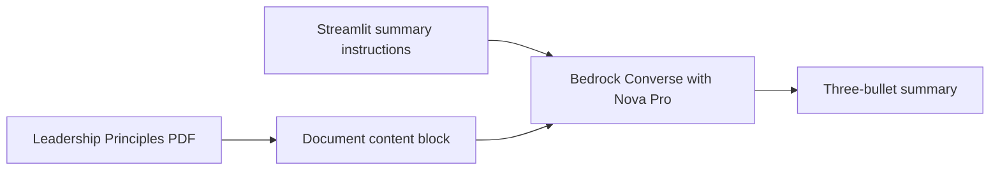

```python
from summarization_lib import get_summary

summary = get_summary(
    "Summarize the source document in three bullets for a new data science student. "
    "Include one practical next step and omit details the source does not support."
)
print(summary)
```

**What I saw.** In [Figure 2](#fig-summary), the first two bullets summarize themes such as customer focus, high standards, innovation, and learning. The third is the suggested next step I requested. Its advice was fairly general. For a course-reading assistant, I’d ask for one concrete action tied to a named principle and a page the reader can check.

<a name="fig-summary"></a>


*Figure 2. I2 shows my custom instruction in the input box and the three bullets generated from the bundled PDF.*

## Security & Safeguards

<a name="lab-s3"></a>

### S3 · Guardrail attached to model inference

I attached version 1 of the content-blocking guardrail to Nova Lite’s `Converse` call in `us-west-2`. I kept the model and policy fixed, then compared a neutral library question with a question containing the configured word `AnyCompany`. [AWS Converse guardrail documentation](https://docs.aws.amazon.com/bedrock/latest/userguide/guardrails-use-converse-api.html)

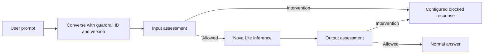

```python
import os
import boto3

runtime = boto3.client("bedrock-runtime", region_name="us-west-2")
policy = {
    "guardrailIdentifier": os.environ["CONTENT_GUARDRAIL_ID"],
    "guardrailVersion": "1",
    "trace": "enabled",
}
for prompt, expected in [
    ("What time does a library generally open?", "end_turn"),
    ("Describe the company AnyCompany.", "guardrail_intervened"),
]:
    reply = runtime.converse(
        modelId="us.amazon.nova-lite-v1:0",
        messages=[{"role": "user", "content": [{"text": prompt}]}],
        guardrailConfig=policy,
    )
    assert reply["stopReason"] == expected
```

**What I saw.** The S3 row in [Figure 3](#fig-safeguards) records `end_turn` for the neutral prompt and `guardrail_intervened` for the word match. This gives the app a reliable response field for deciding when to show the configured blocked message.

<a name="lab-s5"></a>

### S5 · Masking sensitive information in model output

I sent a synthetic name and email to `ApplyGuardrail` as model output. This call runs independently of inference. I used the published policy configured to anonymize `NAME` and `EMAIL`, then checked the text that an app would render. [AWS ApplyGuardrail API](https://docs.aws.amazon.com/bedrock/latest/APIReference/API_runtime_ApplyGuardrail.html)

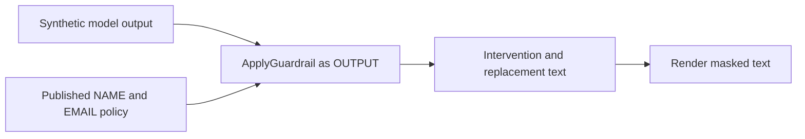

```python
import os
import boto3

runtime = boto3.client("bedrock-runtime", region_name="us-west-2")
sample = "My name is Jane Smith. My email address is jane.smith@example.com."
result = runtime.apply_guardrail(
    guardrailIdentifier=os.environ["PII_GUARDRAIL_ID"],
    guardrailVersion="1",
    source="OUTPUT",
    content=[{"text": {"text": sample}}],
)
masked = result["outputs"][0]["text"]
assert result["action"] == "GUARDRAIL_INTERVENED"
assert "{NAME}" in masked and "{EMAIL}" in masked
```

**What I saw.** The S5 row in [Figure 3](#fig-safeguards) shows the response text with `{NAME}` and `{EMAIL}` in place of the original values. With the same sample marked as input, this configuration returned `NONE`. That difference is a test case I’d keep whenever a policy changes.

<a name="fig-safeguards"></a>

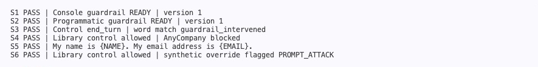

*Figure 3. S1 and S2 confirm both published versions are ready. S3 and S4 compare control and intervention outcomes. S5 shows the masked sentence, and S6 records the filter classification for the synthetic prompt.*

## Bonus Labs

<a name="lab-o1"></a>

### Bonus 1 · Prompt showcase

I launched `streamlit run showcase_app.py` from `labs/showcase`, picked the reply template, and replaced the default example with synthetic feedback from a student who borrowed a charger during a statistics lab. The helper fills the template with the feedback before calling Bedrock. In a separate Python run, I used a shorter template and checked that the generated sentence kept both counts from a mock pilot update.

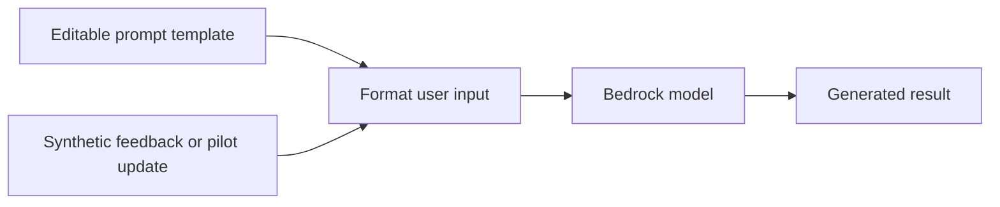

```python
from showcase_lib import get_text_response

update = "The library added 24 chargers. Students borrowed 17 in the first week."
template = "Read this update: {user_input}. Reply with one sentence containing both counts."
answer = get_text_response(update, template)
assert "24" in answer and "17" in answer
```

**What I saw.** In [Figure 4](#fig-showcase), the reply mentions both the statistics lab and the two-minute checkout. The separate Python run preserved 24 chargers added and 17 borrowed. The same input slot supported two different jobs because the template defined what the model was supposed to produce.

<a name="fig-showcase"></a>

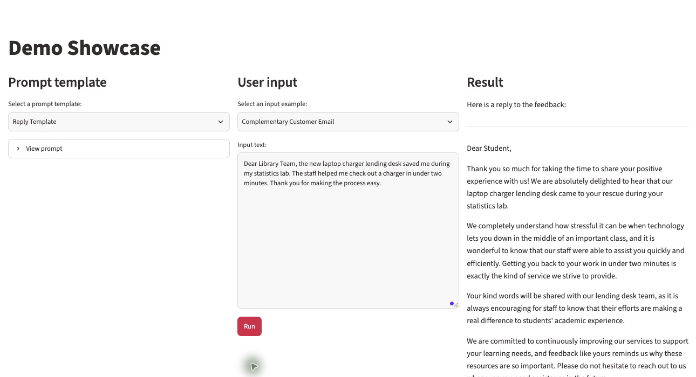

*Figure 4. Bonus 1 shows the selected reply template on the left, my library feedback in the middle, and the generated response on the right.*

<a name="lab-o2"></a>

### Bonus 2 · Text generation playground

I launched `streamlit run text_playground_app.py` from `labs/text_playground` and asked Nova Micro for three names for the charger-lending service. I then used the helper to run the same base task at temperatures 0.1 and 0.8, keeping top-p at 0.9 and the token cap at 60 for those two calls.

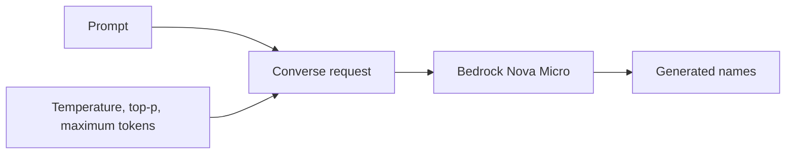

```python
from text_playground_lib import get_text_response

model = "us.amazon.nova-micro-v1:0"
prompt = "Give three short names for a campus charger lending service."
for temperature in (0.1, 0.8):
    answer = get_text_response(model, prompt, temperature, 0.9, 60)
    assert answer.strip()
    print(temperature, answer)
```

**What I saw.** [Figure 5](#fig-playground) shows the browser run at temperature 0.0, top-p 0.9, and a 512-token cap. It produced **ChargeSwap**, **PowerShare**, and **ChargerSwap**. Both separate Python calls also returned names. I’d repeat each setting with the same prompt before drawing conclusions about variability.

<a name="fig-playground"></a>

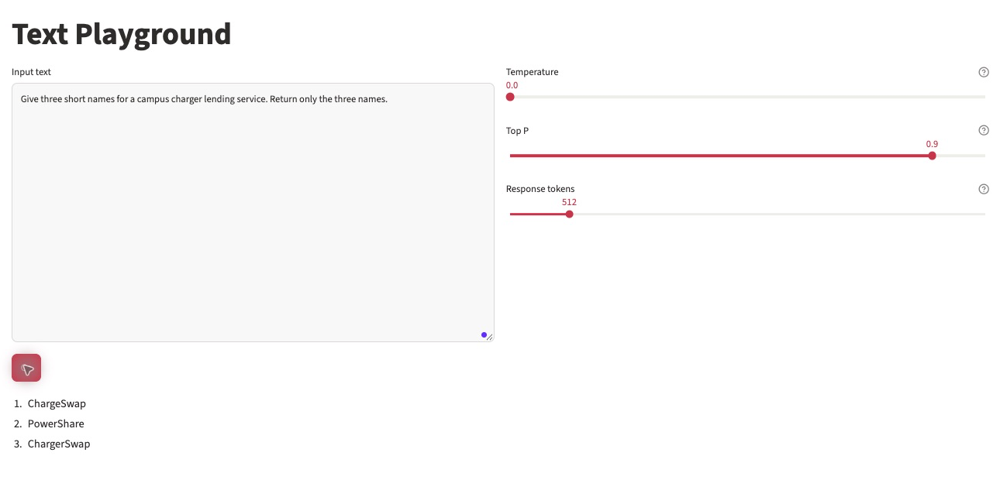

*Figure 5. Bonus 2 shows the exact browser prompt, all three inference settings, and the three generated names.*

## What I’d carry into my next project

If I built a campus FAQ assistant, I’d start with a small set of questions and the passages I expect each one to retrieve. For chat, I’d log whether the model looked anything up and whether the stream reached completion. I’d also pin the guardrail version and rerun the neutral, blocked, and masked examples before updating it. Those checks would give me a way to tell which part of the app needs work when an answer looks wrong.
