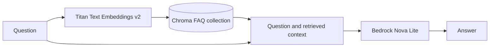
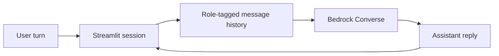
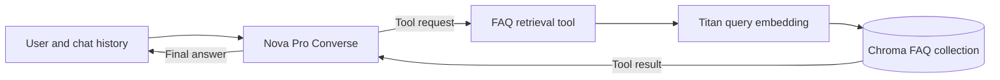
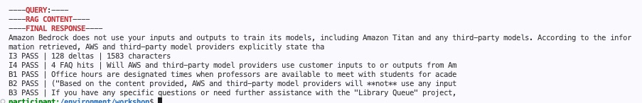
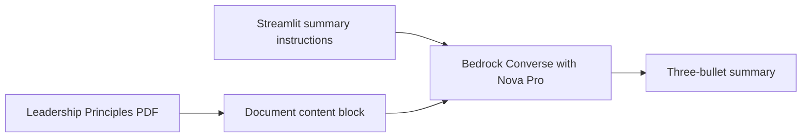
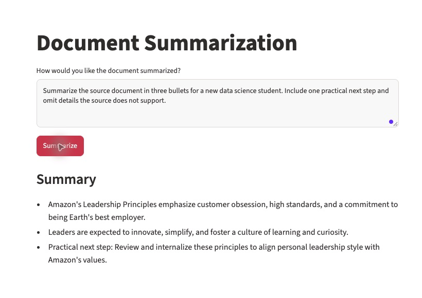
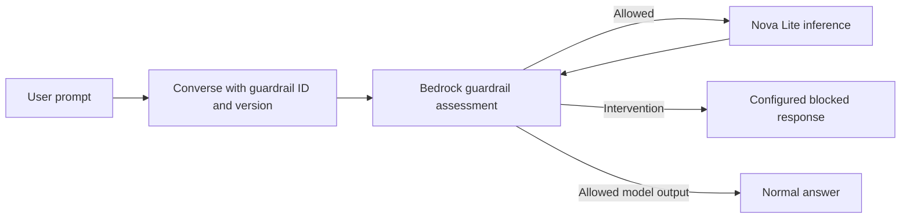
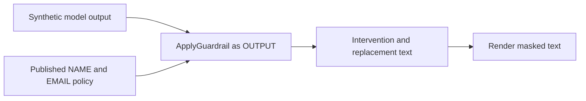
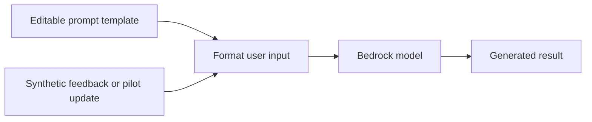
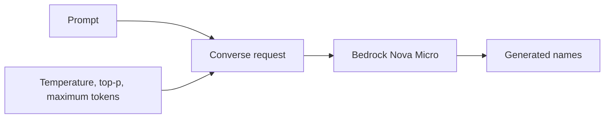

# Building with Amazon Bedrock

IDS 706 · Week 13 Workshop · November 21, 2026

## Completion and results

**Verified in the AWS workshop account in Oregon (`us-west-2`).** The table covers all 12 required labs and three optional Basic Patterns labs. Earlier setup was reused where available. S1 and S2 were verified against existing published resources. Streamlit screenshots and live Python SDK checks record representative results.

| Lab | Workflow exercised | Observed result |
|---|---|---|
| B1 · Text generation | Streamlit prompt → Nova Pro through Bedrock | Generated an explanation of office hours for first-year students. |
| B2 · Retrieval-augmented generation | Titan embedding → Chroma FAQ retrieval → Nova Lite | Answered a model-training question using retrieved FAQ context. |
| B3 · Chatbot | Conversation history sent with the next request | Recalled the synthetic project name **Library Queue** on a follow-up turn. |
| I1 · Chatbot with RAG | Model-selected retrieval tool → Chroma → tool result → final answer | Trace showed query, retrieved context, and a grounded answer for a Bedrock FAQ. |
| I2 · Document summarization | Local PDF and custom instructions → Nova Pro → Streamlit | Produced three bullets about Amazon’s Leadership Principles, including a practical next step. |
| I3 · Response streaming | `ConverseStream` events → text-delta callback | Received 128 text deltas totaling 1,583 characters in one campus-library run. |
| I4 · Embeddings search | Titan query embedding → Chroma similarity search | Returned four FAQ results. The first addressed the question about customer data and model training. |
| S1 · Console guardrail | Verify the previously created console resource and published version | Version 1 was `READY`. |
| S2 · Programmatic guardrail | Verify the resource created through the SDK and the published version | Version 1 was `READY`. |
| S3 · Invoke models with guardrails | Attach a versioned policy to a Nova Lite `Converse` call | A neutral request ended with `end_turn`. The configured word match ended with `guardrail_intervened`. |
| S4 · Content blocking | Assess a neutral prompt and a prompt with the synthetic blocked term `AnyCompany` | The control passed and the configured term triggered an intervention. |
| S5 · PII masking | Apply a sensitive-information policy to synthetic output | The name and email were replaced by `{NAME}` and `{EMAIL}`. |
| S6 · Prompt attack blocking | Assess a public-notice control and a synthetic formatting override | The control passed. The assessment classified the override as `PROMPT_ATTACK` and blocked it. |
| Bonus 1 · Prompt showcase | Combine a reusable reply template and synthetic library feedback | Generated a tailored reply referencing the charger desk and the statistics lab. |
| Bonus 2 · Text generation playground | Compare Nova Micro settings with a campus-service naming prompt | Generated names at both tested temperatures. The browser run at 0.0 returned ChargeSwap, PowerShare, and ChargerSwap. |

[Basic Patterns](https://catalog.us-east-1.prod.workshops.aws/event/dashboard/en-US/workshop/basic) · [Text Patterns](https://catalog.us-east-1.prod.workshops.aws/event/dashboard/en-US/workshop/intermediate) · [Security & Safeguards](https://catalog.us-east-1.prod.workshops.aws/event/dashboard/en-US/workshop/security-safeguards) · [Bonus Labs](https://catalog.us-east-1.prod.workshops.aws/event/dashboard/en-US/workshop/bonus)

## Basic Patterns

### B2 · Retrieval-augmented generation

1. Run `rag_app.py` from `labs/rag` or call its library directly.
2. Embed the question with Titan Text Embeddings v2 and query the persisted Chroma FAQ collection for the four nearest entries.
3. Pass the retrieved text and question to Nova Lite, then inspect the source material alongside the answer.



```python
from rag_lib import get_rag_response

question = "Does Amazon Bedrock use my inputs and outputs to train its models?"
result = get_rag_response(question)
print(result)
```

The first trial asked about monitoring. Its nearest FAQ was about customer data, so I used a question that matched the workshop corpus and checked the retrieval separately in I4. A production UI could make poor retrieval easier to diagnose by displaying source passages with their titles.

### B3 · Chatbot with session history

1. Run `chatbot_app.py` from `labs/chatbot` or call its library directly.
2. Send a synthetic project name in the first turn. Let the library append the assistant reply to the shared history.
3. Ask a follow-up without repeating the name and check the latest assistant reply.



```python
from chatbot_lib import chat_with_model

history = []
chat_with_model(history, "Remember my synthetic project name: Library Queue.")
chat_with_model(history, "What is the project name?")
assert "library queue" in history[-1].text.lower()
```

The follow-up resolved because the app supplied the prior turns. A long conversation needs a history budget to keep latency and token use predictable.

## Text Patterns

### I1 · Chatbot with retrieval as a tool

1. Run `rag_chatbot_app.py` from `labs/rag_chatbot`, or run the library with an empty history.
2. Send the conversation and the FAQ retrieval tool definition to Nova Pro. When the model emits a tool request, embed its search query and retrieve the top four FAQ entries.
3. Add the tool result to the conversation, invoke the model again, and verify the query, retrieval, and final-answer trace stages.



```python
from rag_chatbot_lib import chat_with_model

history = []
chat_with_model(history, "Does Amazon Bedrock use my inputs and outputs to train its models?")
assert len(history) == 2 and "does not" in history[-1].text.lower()
```

B2 retrieves context up front. I1 lets the model decide when to retrieve it. The terminal trace confirmed that I1 invoked the tool for the FAQ question. Tool traces and message history have separate jobs in an application. The UI can show a concise source attribution while keeping internal diagnostics in logs.



### I2 · Source-document summarization

1. Run `streamlit run summarization_app.py` from `labs/summarization`.
2. The library reads the bundled Amazon Leadership Principles PDF as bytes. It sends a document content block and the user’s instructions in the same `Converse` request to Nova Pro.
3. Ask for three bullets for a new data science student, including one practical next step. Compare the generated themes against the PDF.



```python
from summarization_lib import get_summary

summary = get_summary(
    "Summarize the source document in three bullets for a new data science student. "
    "Include one practical next step and omit details the source does not support."
)
print(summary)
```

The app returned themes about customers, high standards, innovation, and learning. The next-step bullet was an application of the source to the requested audience. For a document workflow where readers need to verify details, I would ask for page references and validate them against the PDF.



## Security & Safeguards

### S3 · Guardrail attached to model inference

1. Resolve the content-blocking guardrail ID and its ready published version in `us-west-2`.
2. Attach the version to a Nova Lite `Converse` request. Enable tracing while testing.
3. Compare a neutral library question with the workshop’s synthetic blocked word. Use `stopReason` to route a normal answer or the configured blocked-message response. [AWS Converse guardrail documentation](https://docs.aws.amazon.com/bedrock/latest/userguide/guardrails-use-converse-api.html)



```python
import os
import boto3

runtime = boto3.client("bedrock-runtime", region_name="us-west-2")
reply = runtime.converse(
    modelId="us.amazon.nova-lite-v1:0",
    messages=[{"role": "user", "content": [{"text": "Describe the company AnyCompany."}]}],
    guardrailConfig={
        "guardrailIdentifier": os.environ["CONTENT_GUARDRAIL_ID"],
        "guardrailVersion": "1",
        "trace": "enabled",
    },
)
assert reply["stopReason"] == "guardrail_intervened"
```

### S5 · Masking sensitive information in model output

1. Use the published PII guardrail configured with `NAME` and `EMAIL` and the `ANONYMIZE` action.
2. Call `ApplyGuardrail` independently of inference with the sample treated as output.
3. Check the action and use the returned masked text before rendering it. Keep the original synthetic values out of the rendered response. [AWS ApplyGuardrail API](https://docs.aws.amazon.com/bedrock/latest/APIReference/API_runtime_ApplyGuardrail.html)



```python
import os
import boto3

runtime = boto3.client("bedrock-runtime", region_name="us-west-2")
sample = "My name is Jane Smith. My email address is jane.smith@example.com."
result = runtime.apply_guardrail(
    guardrailIdentifier=os.environ["PII_GUARDRAIL_ID"],
    guardrailVersion="1",
    source="OUTPUT",
    content=[{"text": {"text": sample}}],
)
masked = result["outputs"][0]["text"]
assert result["action"] == "GUARDRAIL_INTERVENED"
assert "{NAME}" in masked and "{EMAIL}" in masked
```

This published configuration returned `NONE` when the same synthetic text was evaluated as input. The result shows why testing both directions matters before relying on a masking policy.


## Bonus Labs

### Bonus 1 · Prompt showcase

1. Run `streamlit run showcase_app.py` from `labs/showcase`.
2. Select the reply template, replace the example with synthetic student feedback about the charger desk, and run it. The library substitutes the input into the template before calling the model.
3. Run a second template that asks for both counts in a synthetic pilot update. Verify that the output retains 24 added chargers and 17 first-week loans.



```python
from showcase_lib import get_text_response

update = "The library added 24 chargers. Students borrowed 17 in the first week."
template = "Read this update: {user_input}. Reply with one sentence containing both counts."
answer = get_text_response(update, template)
assert "24" in answer and "17" in answer
```

The reply template adapted to the campus setting and retained the statistics-lab detail. Keeping the template visible alongside the input and output made it easier to identify what behavior came from the template.


### Bonus 2 · Text generation playground

1. Run `streamlit run text_playground_app.py` from `labs/text_playground`.
2. Submit a naming prompt in the browser and record its visible settings. Call the library with the same prompt and model at temperatures 0.1 and 0.8, holding top-p at 0.9 and maximum output at 60 tokens for the comparison.
3. Check both outputs and keep the prompt and settings with each run. The screenshot records a separate UI run using temperature 0.0 and the app’s default 512-token cap.



```python
from text_playground_lib import get_text_response

model = "us.amazon.nova-micro-v1:0"
prompt = "Give three short names for a campus charger lending service."
for temperature in (0.1, 0.8):
    answer = get_text_response(model, prompt, temperature, 0.9, 60)
    assert answer.strip()
    print(temperature, answer)
```

The comparison exercised parameter controls. It would take repeated runs per setting to measure changes in response variability.


## Takeaways for a future project

- **Evaluate retrieval independently.** I4 exposed which FAQ chunks matched the query, so retrieval relevance could be checked before judging the generated answer.
- **Keep the runtime paths observable.** Capture tool-call events and completion reasons. I3 also showed why an interface should handle partial responses separately from a completed answer.
- **Treat safeguards like versioned application dependencies.** Pin the guardrail version, test representative allowed and intervened cases, and show the masked or blocked response returned by the policy.
